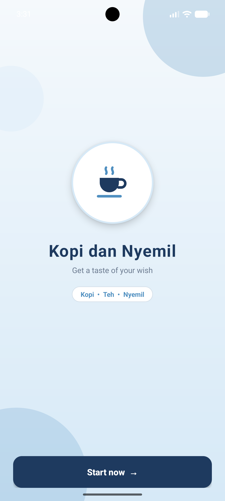
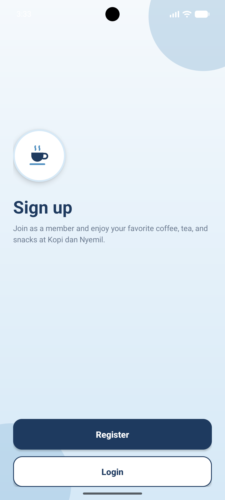
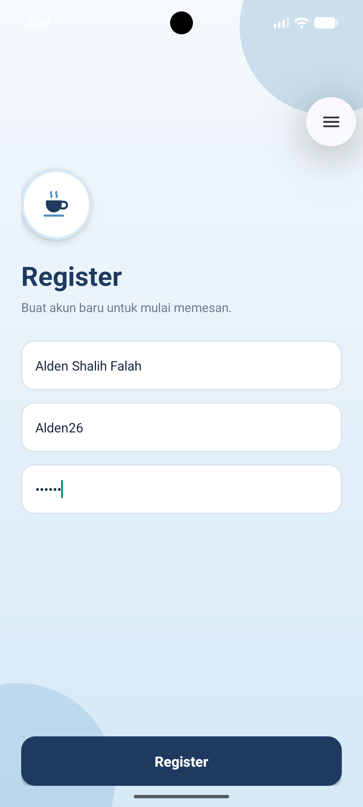
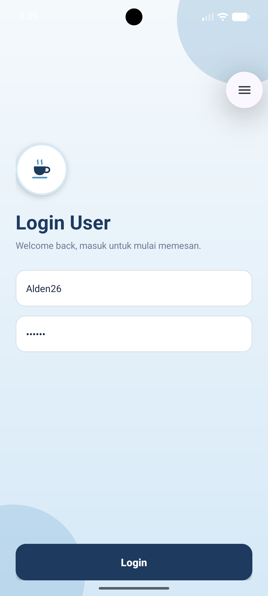
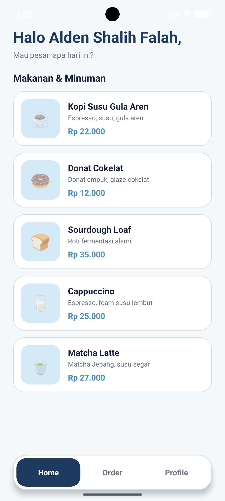
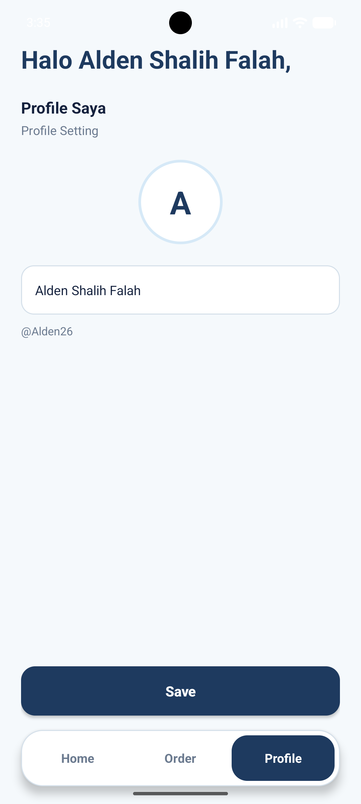
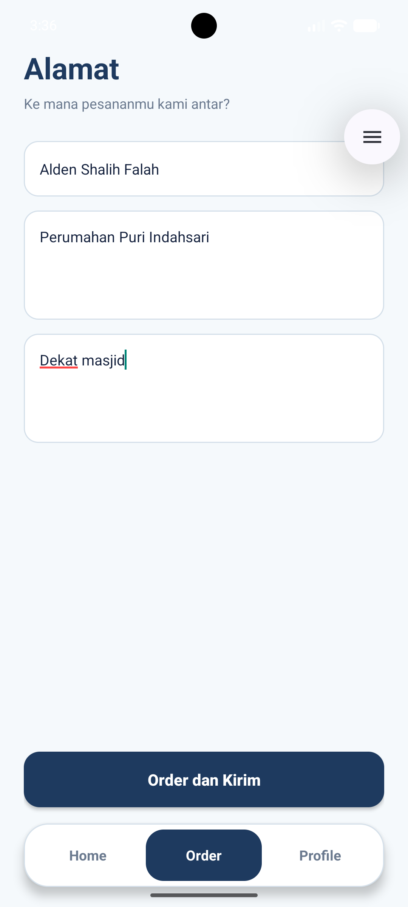
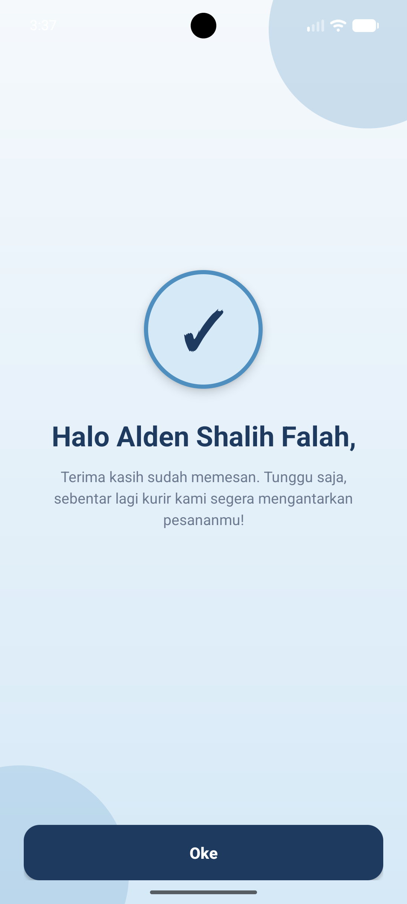

# Kopi dan Nyemil

Aplikasi mobile pemesanan kopi, teh, dan camilan bertema kafe modern bernuansa biru. Dibuat untuk tugas UTS mata kuliah Pengembangan Aplikasi Mobile.

## Identitas
- Nama: Alden Shalih Falah
- NIM: 1247050050
- Kelas: A
- Kampus: UIN Sunan Gunung Djati Bandung

## Fitur
- Splash/Welcome screen
- Sign Up dengan pilihan Register atau Login
- Register akun baru dengan validasi kolom kosong
- Login dengan pengecekan username dan password
- Home berisi 5 menu makanan dan minuman (nama, deskripsi, harga)
- Bottom navigation (Home, Order, Profile)
- Profile: melihat dan mengubah nama
- Alamat pengiriman: nama, alamat, patokan, dengan validasi
- Konfirmasi pesanan dengan sapaan nama penerima

## Teknologi
- Bahasa: Kotlin
- IDE: Android Studio
- UI: XML Layout (View-based)
- Minimum SDK: API 24 (Android 7.0)
- Data: dummy/statis, tanpa database (akun disimpan sementara di memori lewat object Kotlin)

## Cara Menjalankan
1. Clone repository: `git clone https://github.com/aldenfalah/AppKopiDanNyemilAlden.git`
2. Buka folder project di Android Studio.
3. Tunggu Gradle sync selesai.
4. Pilih emulator (misalnya Pixel 7) atau perangkat Android asli.
5. Klik tombol Run.

Alur uji: Start now > Register > isi data > Home > Order (isi alamat) > Order dan Kirim > Konfirmasi > Oke.

## Catatan
Karena tanpa database, akun yang didaftarkan hilang saat aplikasi ditutup total, sehingga perlu Register ulang.

## Screenshot

| Splash | Sign Up | Register | Login |
|--------|---------|----------|-------|
|  |  |  |  |

| Home | Profile | Alamat | Konfirmasi |
|------|---------|--------|------------|
|  |  |  |  |